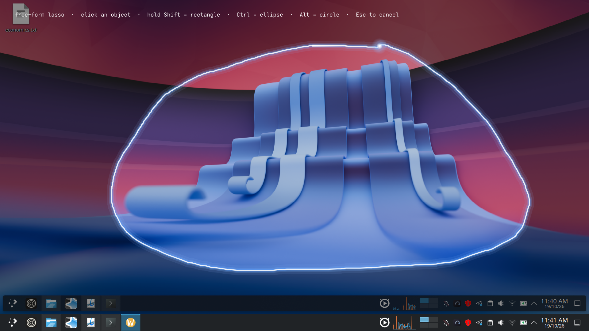
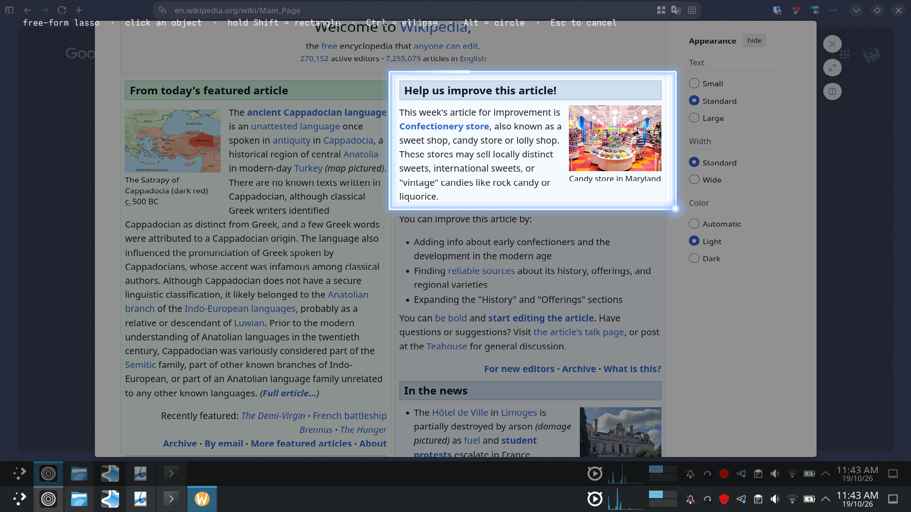
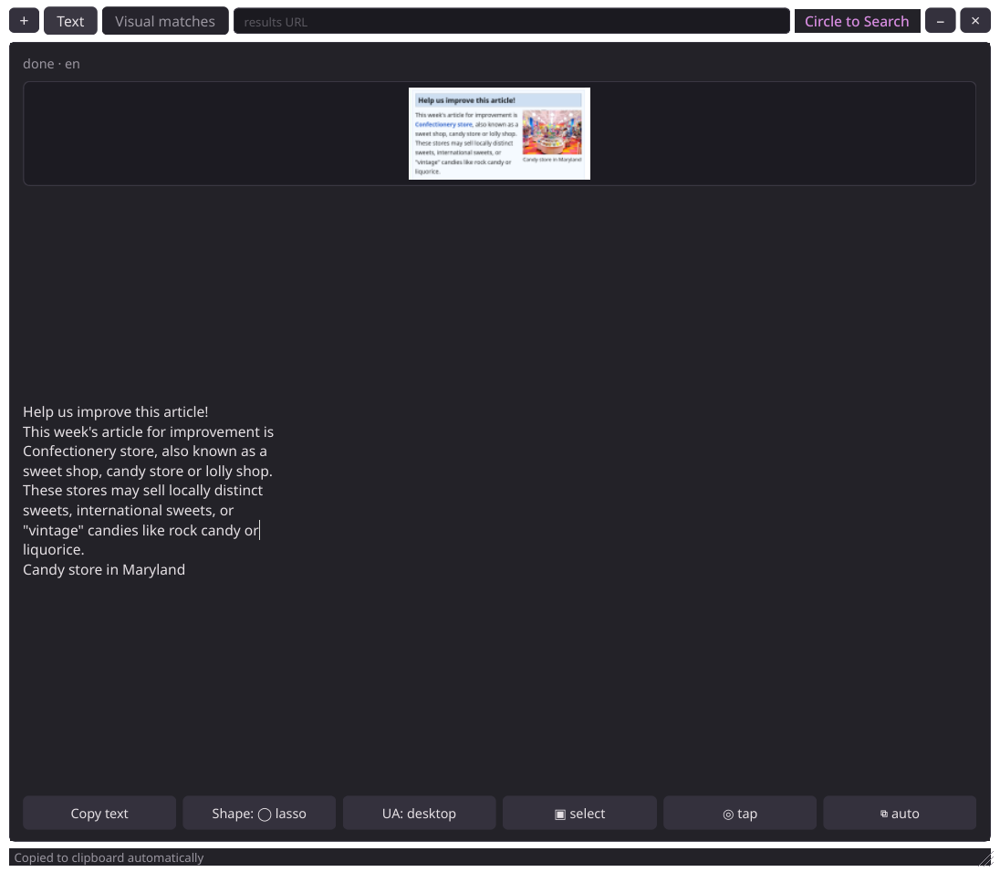
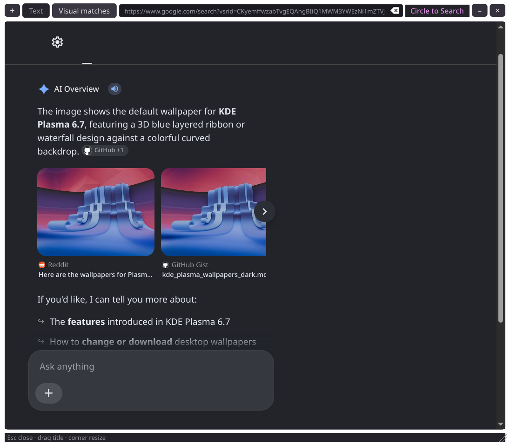

# kcircle

Circle to Search for KDE Plasma on Wayland — OS-level selection, results in a
small overlay. No browser window.

Android's Circle to Search is a system feature: you lasso anything on any app
and Google answers. On desktop the official equivalents are all locked inside
the browser. Chrome's Lens overlay only sees the current web page, and Gemini's
"Select from screen" is limited to Chromebook Plus, Mac and Windows.

kcircle brings the gesture to the whole desktop. Freeze the screen, draw around
anything — a PDF, a video, a terminal, a photo on your desktop — and the
results land in a compact always-on-top panel.

## Screenshots

**Free-form lasso** — the default gesture. Draw a shape around anything; the
crop is masked to your stroke and trimmed tight, so Lens sees what you circled
rather than the screen around it.



**Tap or scribble** — a short stroke is not a mistake. Point at something and
click to search that object, or scribble over a run of text and it is read
directly. Either way the region is found by layout analysis of the frozen
frame: no model, no extra dependency.



**Text** — server-side OCR through Google's own endpoint, so every script and
font works and your CPU stays idle. Selectable, and copied to the clipboard
automatically if you ask for it.



**Visual matches** — the full Lens result set in an embedded view, left exactly
as a browser would render it.



> These predate the navigation bar and the two-row header, so their toolbars
> show the older layout. The gestures and the results they demonstrate are
> unchanged.

## Features

- **Works on any application.** Capture is compositor-level, not
  browser-level.
- **Copy text without opening anything.** Hold Super while you draw and the
  text goes straight to the clipboard — no panel, no window.
- **True Circle to Search.** Draw a lasso around a subject and the crop is
  masked to your stroke and trimmed tight, so Lens sees the thing you circled
  rather than the whole screen around it.
- **Animated glow** while you draw: a soft halo, a bright core, a comet tail
  and a spark that rides the cursor.
- **Real Google Lens results** — AI Overview, Exact matches, Visual matches —
  rendered in an embedded view, not a browser window, and left completely
  untouched: no CSS, no JavaScript, no zoom. What you see is what a browser
  would show.
- **Browse the results, don't just stare at them.** Back, forward, reload, a
  history dropdown of every URL visited in the panel, an editable URL bar, and
  the standard right-click menu — save a page, copy a link address, open a link
  in a new tab.
- **Text in any language.** Scribble over a run of text and it is read by
  Google's own OCR server-side, so every script and font works and your CPU
  does nothing. The result is selectable and copyable.
- **Auto-copy** — flip `⧉` and the result lands on your clipboard the moment
  it arrives, so you can paste without reaching for the panel. Off by default,
  because silently replacing the clipboard can lose work.
- **QR codes and barcodes** are decoded locally and shown above the OCR text.
  Install the optional decoder with `uv pip install zxing-cpp` (or the `qr`
  extra); without it QR images are still searched as pictures.
- **Tap to search.** The screen is scanned while the overlay opens and the
  objects on it are outlined. A single click selects whatever is under the
  cursor — the same gesture as Circle to Search, where you tap the boots and
  scribble the bag.
- **Scribble to search.** Draw a loose loop around one thing and it snaps to
  that thing. A big deliberate lasso is always honoured exactly as drawn.
- **Free-form by default.** Circling by hand is what Circle to Search is named
  for, so that is what you get with nothing held.
- **Change shape without lifting the mouse.** Hold a modifier at any point
  mid-drag and the selection becomes exactly that shape:

  | Held | Shape |
  | --- | --- |
  | *nothing* | free-form lasso |
  | `Shift` | rectangle |
  | `Ctrl` | ellipse |
  | `Alt` | circle |
  | `Shift` in `corner` mode | square |

  Swap straight from one modifier to another mid-stroke — no need to let go of
  one first — and when several are held the order is `Alt` > `Ctrl` > `Shift`.
  Release everything and you are back to your saved shape, which is remembered
  between runs: `lasso`, `ellipse`, `circle`, `rect` or `corner`.
- **Three capture scopes** — draw a region, grab the active window, or take
  the whole screen.
- **Reusable.** The `+` button starts another capture; the panel gets out of
  the way while you select.
- **Minimize without losing the result.** The `–` button hides the panel and
  keeps the app alive with everything still loaded. It goes to the **system
  tray**, and a notification says so — a frameless always-on-top panel has no
  taskbar entry, so without that it would simply vanish. Click the tray icon
  to bring it back.

Launching kcircle while it is already running starts a new search in the
existing resident process instead of starting a second session. The tray icon
and its **Restore panel** menu action remain the way to restore a minimized
result panel.

  On a desktop with **no system tray**, minimize still works but there is
  nowhere to retrieve the panel from. `KCIRCLE_LOG=debug` says so at startup;
  The only way to end the resident process is **Quit** in the tray menu.
- **User-agent switch** between Google's mobile and desktop presentations,
  remembered between runs.
- **Last tab** — Text or Visual matches, reopened on the next launch.
- **Resizable and movable**, with position and size remembered.

## Copy text without opening anything

Hold **Super** while you draw and the text under your stroke goes straight to
the clipboard. No panel, no window, no interruption.

It uses Super because Shift, Ctrl and Alt are already taken by the shape keys.
Super is orthogonal to them — it changes what happens when you let go, not how
the stroke is drawn — so every shape still works:

| Held | Shape | What happens on release |
| --- | --- | --- |
| — | your saved shape (free-form lasso by default) | open the results panel |
| `Shift` | rectangle | open the results panel |
| `Ctrl` | ellipse | open the results panel |
| `Alt` | circle | open the results panel |
| `Super` | your saved shape | **copy the text, open nothing** |
| `Super`+`Shift` | rectangle | **copy the text, open nothing** |
| `Super`+`Ctrl` | ellipse | **copy the text, open nothing** |
| `Super`+`Alt` | circle | **copy the text, open nothing** |

It works on a tap too, and on a scribble that snaps to an object. You can press
or release Super mid-drag, exactly like the shape keys.

Decoded QR and barcode values come first, then the recognised text, then the
translation if one was asked for — the same order **Copy text** uses.

This path ignores the **auto-copy** setting. Holding Super is already the
request to copy, and silently doing nothing because a separate toggle is off
would be the wrong answer. Auto-copy remains off by default for the normal
path, where it would replace your clipboard unasked.

Since no panel appears, a tray notification reports what happened — how much
was copied, or that nothing readable was found. Without it, silence would look
identical to a failed gesture.

## Tap and scribble

Circle to Search on Android never waits for you to circle something: it
segments the screen the instant it freezes, then just checks your touch
against that pre-computed grid. kcircle does the same thing, locally.

While the overlay is opening, a background thread reduces the frozen frame to
a small binary edge map and runs recursive projection (XY-cut) layout analysis
on it — the same classic technique used to segment scanned documents. It cuts
the screen on empty gutters until the regions stop dividing, then keeps the
leaves that look like real things on it. Every pixel-level step runs inside
Pillow's C code; Python only walks a few hundred projection entries, so the
whole pass is a few tens of milliseconds on a 1080p capture.

Deliberately, it is a heuristic and not a neural network:

- No model, no download, no GPU, and **no new dependencies** — it uses the
  Pillow that was already there.
- When nothing is found (a gradient, a video, a dense wall of text) it says
  so quietly. A click then falls back to a small box around the cursor, which
  is a perfectly good search — you are never blocked.
- Snapping is deliberately conservative: it only fires when the stroke is
  small, exactly one object is inside it, and that object is clearly smaller
  than the stroke. Otherwise your lasso is used verbatim.

Turn it off with `KCIRCLE_NO_SNAP=1`, or from the `◎ tap` button in the panel.

Text is never OCR'd here. Draw over text and the crop goes to Google's own
endpoint via `chrome-lens-py`, exactly like the rest of the app, so all
languages and fonts are handled by the service that owns them.

## Scaled displays and screen coverage

If the overlay ever failed to cover the whole screen — leaving a live strip
along the bottom with a second copy of the panel visible under it — this is
why, and what is done about it.

Qt and `spectacle` count in different units. Qt talks in device-independent
coordinates: on a 1920x1080 panel running at 1.2x, the desktop is 1600x900 as
far as Qt is concerned. `spectacle` captures real device pixels: 1920x1080.
Mixing the two offsets everything by exactly the scale factor.

kcircle therefore never uses Qt's reported `devicePixelRatio` (which is not
reliable under Wayland/XWayland — it reports 2.0 here, which is simply wrong).
Instead it measures the ratio between the two things it actually has:

```
ratio = captured image width / virtual desktop width      # 1920 / 1600 = 1.2
```

Three things follow from that:

- **The launcher prefers Wayland** when `WAYLAND_DISPLAY` is set, so Qt and
  the screenshotter share one display server and one coordinate system.
- **The overlay size is pinned** with `setFixedSize()`. Merely asking a window
  to cover the screen can come back a few pixels short on a scaled output;
  fixing min and max to the same value makes the compositor honour it. This is
  the same trick NormCap uses.
- **The pointer** is hidden only while the overlay is swapping to the frozen
  frame, then comes straight back as a crosshair. You cannot draw around
  something you cannot see yourself pointing at, so it is deliberately not
  hidden for the whole session. Set `KCIRCLE_NO_SIZE_LOCK=1` to opt out of the
  size pin.

This is a scale bug, not a multi-monitor one — it happens on a single display
just as easily.

## The panel

Every control writes itself to `settings.json`, so you set things once.

| Button | What it does |
| --- | --- |
| `+` | start another capture (the panel hides while you select) |
| `←` / `→` | back / forward through the pages the panel has loaded |
| `⌂` | reload the Lens result this panel came from |
| `⋮` | history — every URL visited in this panel, newest first |
| `⟳` | reload the current page |
| results URL | the current Lens URL — copy it, edit it, open it elsewhere |
| `Circle to Search` | drag the window by it; the text is dropped when the row is tight |
| `–` / `×` | minimize to the tray (app keeps running in background) / quit from tray |

Those eight are the header, in a single row. Everything else lives in one bar
under the results, and stays reachable from both tabs:

| Button | What it does |
| --- | --- |
| `Text` / `Visual matches` | switch between native OCR results and embedded Google results |
| `Copy text` | decoded codes first, then any text, onto the clipboard |
| `◎ tap` | tap-to-search and scribble snapping on/off |
| `⧉` | auto-copy results as soon as they arrive |
| `Shape:` | the shape used when no modifier is held |
| `▣ select` | what gets captured next: region, active window or whole screen |
| `UA:` | Google's mobile or desktop presentation |
| `»` | controls that did not fit — only appears when some are hidden |

The `»` menu exists because the bottom bar genuinely does not fit at the
minimum panel width. Rather than squeeze a button — which clipped `Shape:
lasso` down to a single letter and stranded the ones behind it — the controls
nearest the right edge move into `»`, recomputed on every resize. The tabs are
never hidden.

The panel remembers its size and position across runs. It is written on a
400 ms debounce after any resize rather than only when the panel closes, so a
resize survives a crash or a kill.

Clicking the **tray icon** starts a fresh search in the resident process.
Right-click still raises the usual menu: **Restore panel**, **New search**,
**Quit**. Starting kcircle from the start menu or a global shortcut also starts
a fresh search in that same resident process.

Right-clicking the results gives the usual browser menu — Back, Forward,
Reload, Copy, Copy link address, Save page, and open/save link in a new tab or
window. It is built from QtWebEngine's own `WebAction` values, because PyQt 6
exposes no `createStandardContextMenu()`; nothing is injected into the page to
produce it.

## Capture scopes

| Scope | Behaviour |
| --- | --- |
| `select` | freeze the screen, then draw a region |
| `window` | the focused window only, no drawing step |
| `screen` | the entire screen, no drawing step |

Switch with the **Scope** button. Remembered between runs.

## Selection shapes

| Shape | Gesture |
| --- | --- |
| `corner` | drag corner to corner; hold <kbd>Shift</kbd> to constrain to a square |
| `rect` | plain drag |
| `lasso` | draw freehand around the subject |
| `ellipse` | drag an ellipse |

Switch with the **Shape** button on the panel. The choice is written to
`settings.json` and restored next launch, so the mode you last used is the one
you get back.

Mid-drag overrides:

| Key | Effect |
| --- | --- |
| <kbd>Shift</kbd> | square (in `corner`) · lasso (anywhere else) |
| <kbd>Alt</kbd> | ellipse |

A lasso selection is masked to your stroke before it is sent, so Lens sees
the circled subject rather than its bounding box. The crop is trimmed tight to
the drawn area and everything outside the stroke stays **transparent** — set
`KCIRCLE_CROP_BG=white` if you need a solid background instead. Shapes without
a mask (`rect`, `corner`, `ellipse`) send their bounding box as plain RGB.

## The results page is never touched

kcircle loads the page and gets out of the way. It does not inject CSS, does not
run JavaScript, does not set a zoom factor, and does not restyle anything on
load or on a timer.

This is not a neutral choice — it is the fix for a bug that shipped. An earlier
version carried a stylesheet that hid `header`, `[role="banner"]` and Google's
search form, and injected it on `loadFinished` plus nudges at 900 ms and 2200 ms.
Google re-renders its results while they hydrate, so the sheet landed *after*
the page had already painted: results appeared correctly and then blanked about
a second later, leaving only the parts of the page that were never inside a
`<header>`. Every one of those rules is gone.

The practical consequence is that what you see is what a real browser shows, at
100%, with horizontal scrolling if the panel is narrower than the layout. Widen
the panel for a better fit. There are no settings to tune, because there is
nothing left to tune.

## Why two tabs

Google serves a different layout per user agent, and the useful ones trade off:

| UA | Result set | Layout |
| --- | --- | --- |
| `mobile` | often thin — Google tends to answer with location and local junk | fluid |
| `desktop` | **richer** — real AI Overview and visual matches | fixed ~652px column |

`desktop` is the default because it returns visibly more. Its layout is a
narrower fixed column than the panel, so on a narrow panel you may need to
scroll sideways — that is the same as resizing a browser window, and it is
preferable to scaling the text down for you. Switch to `mobile` if you would
rather have a layout that reflows natively, at the cost of thinner results.

## Install

Requires KDE Plasma 6 on Wayland and [`uv`](https://docs.astral.sh/uv/).

```bash
git clone https://github.com/athulkrishna2015/kcircle.git
cd kcircle
uv run ./kcircle
```

That is the whole install. `uv` reads `pyproject.toml`, builds the
environment on first run, and launches it. There is nothing to activate.

To create the environment up front and reuse it:

```bash
uv venv
uv pip install -r requirements.txt
./kcircle
```

`./kcircle` is a thin launcher that execs the checkout's own `.venv`.

There are no binary releases and no packages. An AppImage was attempted and
removed: bundling PyQt6 and QtWebEngine into one file is a packaging project
of its own, and shipping an image whose launcher called the system `python3`
would have produced something that could not import PyQt6 on any machine. A
clone and `uv run` is the honest answer for a Wayland desktop app.

### Dependencies

| Package | Why |
| --- | --- |
| `PyQt6` | overlay, panel, glow animation, masking |
| `PyQt6-WebEngine` | renders the Google Lens results page |
| `chrome-lens-py` | Lens endpoint client for OCR and translation |

`Pillow` comes in as a `chrome-lens-py` dependency and is what draws the lasso
alpha mask. At runtime you also need `spectacle`, which ships with Plasma.

### A note on size

The environment is roughly **560 MB**, and nearly all of it is QtWebEngine:
`libQt6WebEngineCore.so` alone is ~194 MB, because the wheel bundles a full
Chromium.

If your distribution already ships PyQt6 and QtWebEngine (Arch does:
`python-pyqt6` and `qt6-webengine`), you can build a venv that reuses them and
drop to about **32 MB**:

```bash
uv venv --system-site-packages
uv pip install chrome-lens-py
```

Be aware that some distro combinations are mismatched — Arch currently pairs
PyQt6 6.11.0 with Qt 6.11.2, and `QWebEngineView` aborts on load. kcircle
probes WebEngine in a subprocess at startup, so this failure degrades to
OCR-only instead of taking the app down.

To upgrade later:

```bash
uv pip install --upgrade -r requirements.txt
```

```bash
./kcircle
```

1. The screen freezes and dims.
2. Draw around what you want — box, ellipse, square or lasso. Right-click or
   `Esc` cancels.
3. Results appear in the panel, image search already open. Drag the title to
   move, grab the bottom-right corner to resize, `Esc` to minimize to the tray.
4. Press `+` for another capture — the panel hides while you select.

The header carries `+`, the two tab buttons, a **URL bar** showing the current
Lens result (selectable, copyable, and editable — type a URL and press Enter to
navigate), and `×`. The buttons along the bottom cycle **Shape**, **UA** and
**Scope**, and copy the OCR text to the clipboard. `Esc` minimizes to the tray.

Bind a shortcut in *System Settings → Shortcuts → Custom Shortcuts*:

```
Command: /absolute/path/to/kcircle/kcircle
```

Use the absolute path to the executable. Do not use only `kcircle` unless the
checkout's launcher directory is on KDE's `PATH`; KDE custom shortcuts often
run with a restricted environment. Every invocation sends a new-search request
to the already-running tray process.

## Configuration

`~/.config/kcircle/`

| File | Purpose |
| --- | --- |
| `settings.json` | `{"ua": "desktop"\|"mobile", "mode": "lasso"\|"ellipse"\|"circle"\|"rect"\|"corner", "scope": "select"\|"window"\|"screen", "snap": true, "autocopy": false, "tab": 0\|1, "hint": true}` |
| `geometry.json` | panel position and size |
| `kcircle.log` | debug log, see below |

All are written from the panel buttons, so you rarely need to edit them.

Environment:

| Variable | Effect |
| --- | --- |
| `KCIRCLE_TRANSLATE` | target language code, e.g. `de`, `fr` |
| `KCIRCLE_LOG` | `debug` for verbose logging, or a log file path |
| `KCIRCLE_CROP_BG` | `white` to flatten a lasso crop onto an opaque background; the default keeps it transparent |
| `KCIRCLE_REPROBE` | `1` to re-run the QtWebEngine health check |
| `KCIRCLE_NO_BYPASS_WM` | `1` to drop `BypassWindowManagerHint` from the capture overlay |
| `KCIRCLE_NO_SNAP` | `1` to disable the tap and scribble-to-search detection |

Debug logging records the selection region, the crop size, how much of the
upload the mask covers, and which file is sent to Google — enough to diagnose
a selection that comes back wrong:

```bash
KCIRCLE_LOG=debug ./kcircle
tail -f ~/.config/kcircle/kcircle.log
```

## How it works

1. `spectacle` captures the screen to a PNG. Freezing first sidesteps
   Wayland's ban on live screen capture by third-party clients.
2. A frameless PyQt6 overlay draws the frozen frame, animates the glow, and
   collects the drag as a rectangle, ellipse or lasso path.
3. The selection is cropped locally and, for a lasso, alpha-masked to the
   stroke, so **only the pixels you actually selected are transmitted**.
4. The crop goes to `chrome-lens-py` for OCR and translation, and separately
   to `lens.google.com/v3/upload` for the full search results.
5. Those results render in a `QWebEngineView` exactly as a browser would show
   them, at 100%, untouched.

A note on moving the window: on Wayland a client cannot set its own toplevel
position, so kcircle uses Qt's `startSystemMove()` and lets KWin drive the
drag. Resizing uses a custom corner grip for the same reason.

## Installing to your system

**Run it from the checkout you already have.** kcircle does not need a second
copy. A separate clone under `~/.local/share` means two trees exist, and the
one you are testing is not necessarily the one the launcher starts — which is
not a hypothetical. An earlier version of this very app was being fixed in the
working tree while the installed clone stayed three commits behind, so a bug
report came with screenshots of code that had already been replaced.

Point the launcher at the repository instead:

```bash
# build the environment once, in your checkout
cd /path/to/kcircle
uv venv
uv pip install -r requirements.txt
```

Install the icon at every size the launcher wants:

```bash
cd /path/to/kcircle
for s in 16 22 32 48 64 128 256; do
  mkdir -p ~/.local/share/icons/hicolor/${s}x${s}/apps
  rsvg-convert -w $s -h $s kcircle.svg \
    -o ~/.local/share/icons/hicolor/${s}x${s}/apps/kcircle.png
done
mkdir -p ~/.local/share/icons/hicolor/scalable/apps
cp kcircle.svg ~/.local/share/icons/hicolor/scalable/apps/
gtk-update-icon-cache -f -t ~/.local/share/icons/hicolor
```

Add the launcher entry — note the **absolute** path, since the launcher does
not inherit your shell's `PATH`:

```bash
mkdir -p ~/.local/share/applications
cat > ~/.local/share/applications/kcircle.desktop <<'EOF'
[Desktop Entry]
Type=Application
Name=Circle to Search
GenericName=Screen region search
Comment=Draw around anything on screen and search it with Google Lens
Exec=/path/to/kcircle/kcircle
Icon=kcircle
Terminal=false
Categories=Utility;
Keywords=circle;search;lens;ocr;translate;crop;screenshot;
StartupNotify=false
X-KDE-StartupNotify=false
X-KDE-DBUS-Restricted-Interfaces=org.kde.KWin.ScreenShot2
EOF
update-desktop-database ~/.local/share/applications
```

Then bind a shortcut in *System Settings → Shortcuts → Custom Shortcuts*:

```
Command: /absolute/path/to/kcircle/kcircle
```

After that, `git pull` in the checkout is all it takes to update the installed
app — there is nothing else to reinstall.

If you must keep kcircle on a Windows-formatted (ntfs) partition, be aware that
Chromium does a lot of small-file I/O at startup. Measured cold-import cost
there is ~0.17 s against ~0.15 s on the native filesystem, which is small
enough not to matter — but the code itself is worth keeping on Linux-native
storage.

The panel also has to be found on `PATH`-independent terms: bind the shortcut
to the same absolute path, or `git pull` will update the code but not whatever
the shortcut points at.

The `X-KDE-DBUS-Restricted-Interfaces` line is only needed if you later switch
capture to KWin's own `org.kde.KWin.ScreenShot2` API; the default `spectacle`
path does not require it.

The shipped `kcircle.desktop` sets `StartupNotify=false`. With start-up feedback
on, Plasma pops an animated icon at the pointer every time the overlay opens,
which looks like a stray cursor artefact. If you wrote the desktop entry by
hand and see that icon, add the line.

## Tests

A local matrix of 280 checks covers every scope, shape and user-agent
combination, and asserts the invariants that have actually broken:

- a selection never uploads the whole screenshot, and the visual tab never
  uploads before the crop exists
- the stylesheet never overrides Google's own result layout
- a drag is never mistaken for a tap, and no modifier press is either
- object detection finds the right regions, and finds *nothing* on a blank
  screen rather than inventing targets
- a scribble snaps only when it is unambiguous — a large lasso encircling
  several objects is always honoured verbatim
- the overlay matches the virtual desktop and its size is pinned, so a scaled
  display cannot leave an uncovered strip
- the pointer comes back on its own once the overlay is up
- auto-copy leaves the clipboard alone when a search returns nothing
- **launching always starts a capture** — a guard against any code path that
  could turn the main gesture into a no-op again

```bash
QT_QPA_PLATFORM=offscreen .venv/bin/python tests/test_matrix.py
```

Headless runs cannot exercise compositor, mouse or tray behaviour. Those were
verified against a real Wayland session — which is how the
`QSystemTrayIcon.hideMessage` crash was caught, a bug 153 passing checks had
missed. Changes in those areas need a real desktop to confirm.

Layout is the other blind spot: an off-screen panel will happily lay out at a
width nobody can drag to, and a widget squeezed below its own minimum looks
merely small rather than broken. The matrix therefore asserts that no control
in the bottom bar is ever narrower than it asks for, at every width the corner
grip allows.

The same blind spot applies to QtWebEngine API calls: an off-screen suite cannot
tell you that `WebAction.SaveLinkToDisk` does not exist until a user
right-clicks. Every `WebAction` used by the context menu is checked against the
real engine at runtime, because a menu that raises `AttributeError` on every
invocation looks identical to "no menu appeared" in the offscreen matrix.

## Credits and provenance

Written from scratch. Attribution:

- **[chrome-lens-py](https://github.com/bropines/chrome-lens-py)** (MIT) — pip
  dependency; the client for Google's Lens Protobuf endpoint used for OCR and
  translation.
- **[jaslrobinson/circle-to-search](https://github.com/jaslrobinson/circle-to-search)** (MIT)
  and **[dinossht/lens-desktop](https://github.com/dinossht/lens-desktop)** —
  prior art read during research. The "freeze → draw → search" concept and the
  idea of showing results in a panel rather than a browser came from them. No
  code was copied from either.

PyQt6/Qt are LGPLv3; chrome-lens-py is MIT. Google Lens is a Google service
with its own terms — kcircle sends your selection to Google the same way the
official feature does.

## Known limitations

- Wayland only. No X11 support.
- Capture depends on `spectacle`, so it is Plasma-specific.
- Results require network access; OCR is the only offline-capable path.
- Google's endpoints are unofficial and may change without notice.
- The selection is a rectangle, ellipse or freehand lasso — not the pressure-
  or curvature-aware stroke of the Android original.
- Google's desktop presentation is a fixed ~652px column. On a narrower panel
  the results scroll sideways rather than being scaled down — kcircle does not
  set a zoom factor, because the old zoom-plus-CSS approach is what made
  results vanish. Widen the panel, or switch to the `mobile` UA.
- The Visual matches tab needs QtWebEngine. If the bundled engine is missing
  or crashes (some distro Qt/PyQt6 combinations abort on load), kcircle detects
  that in a subprocess at startup and falls back to OCR-only rather than
  crashing.
- **Screenshots live in `docs/` and nowhere else.** Images are blocked by
  `.gitignore` everywhere except `docs/`, so a screen capture taken while
  working cannot be committed by accident — this bit once, when a results
  panel was committed and leaked the machine's location. The images in
  `docs/` are deliberate, reviewed, and re-checked before every release.

## License

MIT
